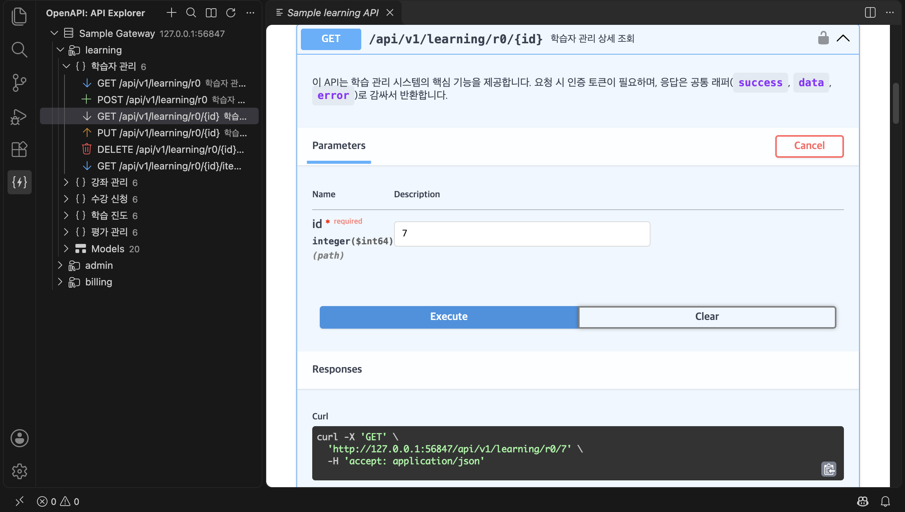
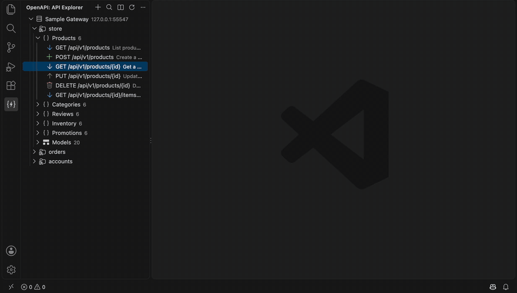
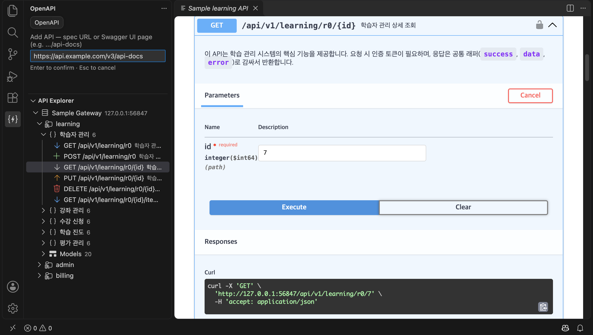

<!-- Language: **English** · [한국어](README.ko.md) -->

# OpenAPI Explorer

> Browse, search, and call any Swagger/OpenAPI gateway without leaving the editor.

A VS Code / Cursor extension that turns a live Swagger/OpenAPI spec into a sidebar
tree plus an embedded Swagger UI — no more opening the docs page in Chrome.

<picture>
  <source media="(prefers-color-scheme: light)" srcset="docs/images/overview-light.png">
  
</picture>



<picture>
  <source media="(prefers-color-scheme: light)" srcset="docs/images/add-api-light.png">
  
</picture>

## Features

- **Sidebar tree** — each registered gateway is a top-level node (its address is shown, and
  credentials are managed from its right-click menu) → tags → endpoints, plus a `Models` node
  for DTOs. Method-colored icons.
- **Jump to Swagger UI** — click an endpoint or model and the embedded Swagger UI opens
  _beside_ your code (deep-link + scroll), without stealing focus (`preserveFocus`).
- **Try it out (via the extension)** — requests are sent from the extension host (Node),
  so they work **without CORS** and still apply your token, proxy, and private CA.
- **Embedded Swagger UI** — the familiar UI, served from bundled assets, so it works
  **offline / behind a firewall**.
- **Endpoint search palette** — fuzzy search by method / path / summary, then jump to it.
- **Code generation** — right-click a tree item to copy the response type (TypeScript, with
  dependent models, JSDoc, and envelope unwrapping), a `fetch` / `axios` client function, or cURL.
- **Multiple gateways, managed like Explorer folders** — ＋ / right-click **Add API**, **Rename**, **Edit URL**,
  **Remove API**; stored in `swaggerViewer.specs`.
- **UI URL auto-discovery** — paste a `.../api-docs` (Swagger UI page) URL and the real spec
  (`/api-docs-json`, `/v3/api-docs`, `-yaml`, …) is discovered automatically. springdoc groups
  (`/v3/api-docs/swagger-config`) appear as one node per group.
- **JSON and YAML, OpenAPI 3.x and Swagger 2.0** — including path-level parameters, Swagger 2
  `body`/`formData` parameters, and relative `servers` URLs.
- **Corporate environments** — proxy, private CA certificate, `strictSSL` toggle, and an
  auth token stored in SecretStorage plus custom headers.

## Usage

1. Click **＋ Add API** in the OpenAPI view (or right-click an API → **Add API…**) and type your spec or
   docs-page URL (`.../api-docs` works) in the inline input above the tree. Enter checks it right away and the
   name is taken from the spec.
   Right-click an API to **Rename** (`F2`), **Edit URL**, **Copy URL** or **Remove API** (`Delete` / `⌘⌫`).
2. Browse the tree, or hit **OpenAPI: Search Endpoints** (`Cmd/Ctrl+Alt+/`).
3. Click an endpoint to open it in Swagger UI; right-click for code generation.

For authenticated APIs, **right-click the gateway node → Set Auth Token** (or run
**OpenAPI: Set Auth Token** and pick the host(s)). The token is stored per host in the OS keychain
(SecretStorage) and sent as `Authorization: Bearer …` only to that host.

If the spec URL itself is behind an HTTP Basic login (browser shows a username/password
prompt, returns `401`), **right-click the gateway node in the tree → Set Username & Password**
(or run the command from the palette). It is stored in SecretStorage and sent as
`Authorization: Basic …`. Credentials are kept **per host** — the tree shows a 🔑 marker with
the saved username, and the palette command can apply one pair to several gateways at once
when they share a login.

## Configuration

| Setting | Default | Description |
| --- | --- | --- |
| `swaggerViewer.url` | `""` | Default spec URL. A UI page (`api-docs`) address auto-discovers the real spec. |
| `swaggerViewer.specs` | `[]` | Register multiple gateways: `[{ "name": "Gateway", "url": "https://api.example.com/api-docs" }]`. |
| `swaggerViewer.headers` | `{}` | Extra HTTP headers sent when fetching the spec. |
| `swaggerViewer.strictSSL` | `true` | Verify TLS certificates. Set `false` only for private-certificate environments. |
| `swaggerViewer.caCertPath` | `""` | Path to a corporate private CA certificate (PEM). |
| `swaggerViewer.proxy` | `""` | Proxy URL. When empty, uses VS Code `http.proxy` or `HTTPS_PROXY`/`HTTP_PROXY`. |

> Settings keys keep the `swaggerViewer.*` prefix for backward compatibility.

## Security notes

- Tokens and passwords are stored per host in the OS keychain (VS Code SecretStorage), never in
  settings files, and are only sent to the host they were saved for.
- Upgrading from 1.1.0 or earlier: the old global token is moved to your registered host if there is
  exactly one. With several hosts you are asked which host(s) it belongs to, and it is not sent until
  you choose.
- An `Authorization` header you put in `swaggerViewer.headers` is sent to **every** host. Prefer the
  per-host token command for credentials.
- Credentials (`Authorization` / `Cookie`) are **dropped on cross-origin redirects** and are
  only sent to the spec's own origin, so a malicious `servers` entry cannot exfiltrate a token.
- `strictSSL: false` is a temporary escape hatch for private-certificate environments — prefer
  `caCertPath` to pin the CA instead.

## Development

```bash
npm install
npm run build        # bundle dist/extension.js (esbuild)
npm run watch        # rebuild on change
npm run lint         # ESLint
npm run typecheck    # tsc --noEmit
npm test             # unit tests (node:test)
```

> The marketplace icon (`media/icon.png`) is a committed asset rendered from `media/icon.svg`.

Press `F5` (Run Extension) to launch an Extension Development Host for debugging.

```text
openapi-explorer/
├─ src/
│  ├─ extension.ts    # activation, tree, commands, SecretStorage token
│  ├─ specLoader.ts   # UI URL → real spec discovery + cache (injectable fetcher → testable)
│  ├─ http.ts         # network: proxy / private CA / strictSSL / headers
│  ├─ swaggerUi.ts    # embedded Swagger UI webview + proxied "Try it out"
│  ├─ model.ts        # structuring + TS type / client / cURL generation
│  ├─ types.ts        # OpenAPI + structured types
│  └─ *.test.ts       # unit tests
├─ scripts/copy-swagger-ui.mjs   # copy bundled Swagger UI assets
├─ esbuild.mjs · tsconfig.json · eslint.config.mjs · .prettierrc.json
├─ .github/workflows/ci.yml
└─ media/             # icon.svg (source) → icon.png, openapi.svg (activity bar)
```

## Packaging (.vsix)

```bash
npm run package      # produces openapi-explorer-<version>.vsix
```

Install the `.vsix` via the Extensions panel `···` → **Install from VSIX…**, or
`cursor --install-extension openapi-explorer-<version>.vsix`.

## License

[MIT](LICENSE) © AzuraLight
